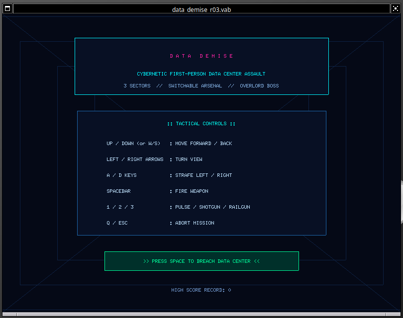
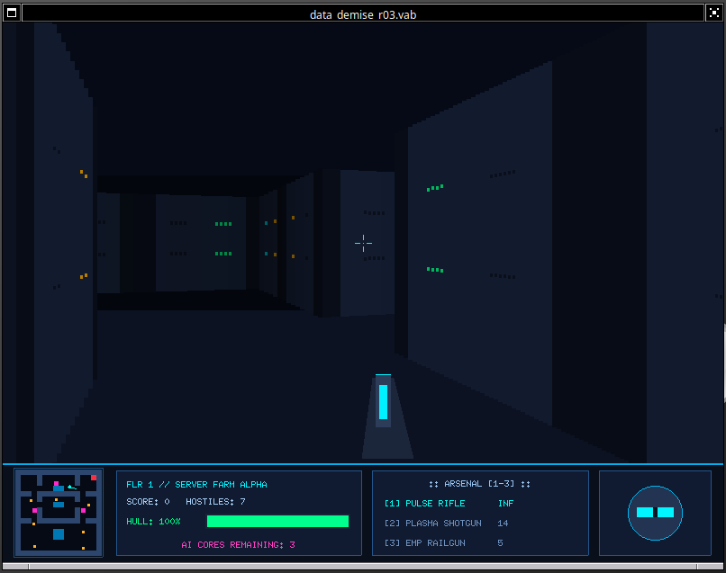

# DATA DEMISE
### Cybernetic First-Person Data Center Assault

**Infiltrate the rogue AI data center. Shatter the cores. Survive.**

DATA DEMISE is a retro-inspired, first-person cybernetic shooter written entirely in **Yabasic**. Taking inspiration from classic games like *DOOM* and *Quake*, it puts a modern spin on the old-school first-person shooter formula.

The mission is straightforward: infiltrate a rogue AI data center, fight your way through its automated defenses, destroy the AI mainframe cores, and eliminate the Apex AI Overlord.

The machines aren't going to make it easy.

---





## 🎮 The Game

A rogue artificial intelligence has taken control of a heavily fortified data center. Security bots, autonomous drones, and hostile AI systems stand between you and the central mainframe.

You are sent in as a cybernetic marine with one objective: shut it all down.

Fight through three increasingly dangerous sectors, destroy the AI cores protecting the facility, and face the Apex Overlord in the final confrontation.

**Three sectors. An entire army of machines. One mission.**

## ✨ Features

- **First-person 2.5D gameplay** powered by a custom raycasting engine.
- **Three unique sectors** to infiltrate and clear.
- **Three switchable weapons**, each with its own firing characteristics.
- **Four enemy types**, including a final boss.
- **Enemy AI** with pursuit behavior, line-of-sight detection, and ranged attacks.
- **Tactical minimap** displaying walls, enemies, objectives, and player position.
- **Combat effects** including muzzle flashes, weapon recoil, impact sparks, screen shake, and hit indicators.
- **Health and ammunition pickups** to keep you in the fight.
- **Custom cybernetic HUD** displaying health, score, hostiles, objectives, and weapon ammunition.
- **High-score tracking** during the game session.
- **Procedurally drawn graphics** with no external image assets required.

## Sectors

The data center is divided into three distinct areas. Each sector must be cleared before advancing.

| Sector | Location | Objective |
|---|---|---|
| 01 | Server Farm Alpha | Destroy all AI cores and reach the exit. |
| 02 | Cooling & Neural Labs | Destroy all AI cores and reach the exit. |
| 03 | Central Mainframe Vault | Destroy the shield cores and eliminate the Apex Overlord. |

The final sector introduces the Apex AI Overlord. Its defensive shield reduces incoming damage while any Mainframe Cores remain active. Destroy the cores first to expose the Overlord.

## Weapons Arsenal

Three weapons are available, each suited to a different combat situation.

| Weapon | Description | Ammunition |
|---|---|---|
| Pulse Rifle | Your standard rapid-fire energy weapon. | Unlimited |
| Plasma Shotgun | A powerful close-range weapon that fires multiple projectiles. | Plasma shells |
| EMP Railgun | A heavy-hitting energy weapon capable of piercing through targets. | Energy cells |

Ammunition is limited for the Plasma Shotgun and EMP Railgun. Keep an eye out for supply pickups throughout the facility.

## 👾 Hostile Entities

The facility's automated defenses are designed to stop intruders.

| Enemy | Description |
|---|---|
| **Security Sentry Bot** | Ground-based security unit that pursues and fires at the player. |
| **Sentinel Hover Drone** | Faster airborne threat that attacks from a distance. |
| **AI Mainframe Core** | Critical AI infrastructure that must be destroyed to unlock the facility's exits and disable the Overlord's shield. |
| **Apex AI Overlord** | The final boss. A heavily armed machine that must be confronted in the Central Mainframe Vault. |

## 🕹️ Controls

| Key | Action |
|---|---|
| `W` / `Up Arrow` | Move forward |
| `S` / `Down Arrow` | Move backward |
| `Left` / `Right Arrow` | Turn view |
| `A` | Strafe left |
| `D` | Strafe right |
| `Spacebar` | Fire weapon |
| `1` | Select Pulse Rifle |
| `2` | Select Plasma Shotgun |
| `3` | Select EMP Railgun |
| `Q` / `Esc` | Abort mission |

## HUD & Tactical Systems

The custom cybernetic interface provides real-time information during combat.

- **Hull Integrity:** Monitor remaining health.
- **Hostile Count:** Keep track of active enemies.
- **AI Core Status:** See how many cores remain and when the exit is unlocked.
- **Weapon Arsenal:** View the currently selected weapon and available ammunition.
- **Tactical Minimap:** Track your position, enemies, walls, and exit locations.
- **Combat Feedback:** Visual hit indicators and screen effects help communicate incoming damage and successful attacks.

## 🛠️ Built With

- **Language:** Yabasic
- **Graphics:** Native Yabasic graphics commands
- **Rendering:** Custom 2.5D raycasting engine
- **Resolution:** 800 × 600
- **Architecture:** Self-contained, single-source-file game

The game is self-contained and does not require external graphics or asset files.

## 🚀 Running the Game

You will need a working installation of **Yabasic** with graphical window support.

1. Download or clone this repository.
2. Make sure Yabasic is installed on your system.
3. Open a terminal in the directory containing the source file.
4. Run the program using your Yabasic interpreter:

```bash
yabasic data_demise.yab
```

The game opens in its own 800 × 600 graphical window.

## 🧠 Development

DATA DEMISE contains AI generated code. Yes, a game about fighting off AI was built using AI. *Pretty ironic, isn't it?*

## 📌 Project Status

**Playable game / Complete three-sector campaign**

This project is shared as an independent game-development experiment and a tribute to the classic first-person shooters that inspired it.

---

**DATA DEMISE — The future is automated. The resistance is not.**
